# 지갑이 (jigabi)


**사기 전에 '이거 사면 이번 달 내 생활'을 보여주고, 산 뒤엔 남은 날을 다시 짜주는 대학생 생활비 웹앱**

<p>
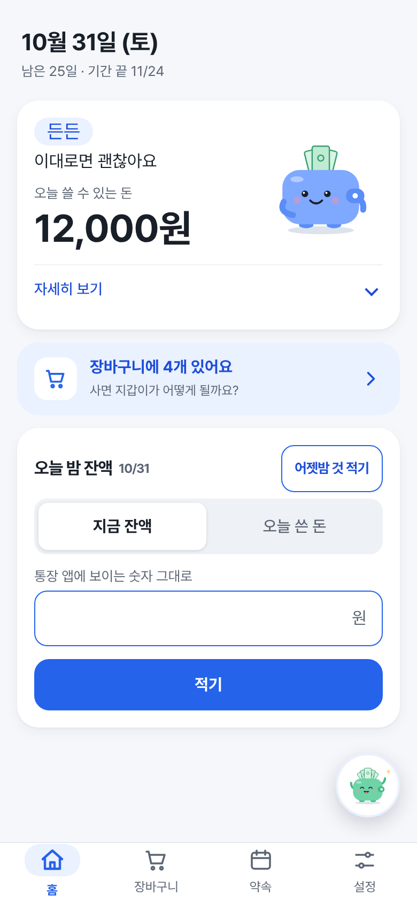

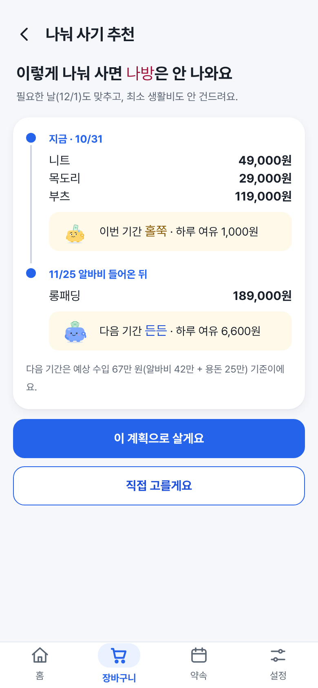
</p>

- FastAPI + Jinja2 + MySQL 8.4, Docker Compose로 한 번에 실행된다
- 로그인 없이 바로 쓴다. 예시 사람(김대학 씨)으로 먼저 둘러볼 수 있다
- 계산 규칙은 [docs/rules.md](docs/rules.md)에 R1~R23으로 정리했고, 확인용 숫자를 테스트 122개(2026-11-28 기준)로 지킨다

---

## 목차

1. [3분 만에 둘러보기](#1-3분-만에-둘러보기)
2. [왜 만들었나](#2-왜-만들었나)
3. [화면과 기능](#3-화면과-기능)
4. [계산은 이렇게 한다 (예시 사람으로 따라가기)](#4-계산은-이렇게-한다-예시-사람으로-따라가기)
5. [실행 방법](#5-실행-방법)
6. [테스트](#6-테스트)
7. [구조](#7-구조)
8. [DB 설계](#8-db-설계)
9. [만들면서 정한 것과 어려웠던 점](#9-만들면서-정한-것과-어려웠던-점)
10. [아직 안 한 것과 한계](#10-아직-안-한-것과-한계)
11. [참고한 코드·자료](#11-참고한-코드자료)
12. [라이선스](#12-라이선스)

---

## 1. 3분 만에 둘러보기

[실행](#5-실행-방법)한 뒤 아래 순서대로 누르면 핵심 기능을 다 볼 수 있다.

| 순서 | 주소 / 누를 것 | 보이는 것 |
|---|---|---|
| 1 | http://localhost:8000/demo | 예시 사람 김대학 씨의 10월 31일(토) 홈. 오늘 쓸 수 있는 돈 **12,000원**, 지갑이 **든든** |
| 2 | 홈의 [자세히 보기] | 남은 기간 534,200원이 고정지출·약속·최소 생활비·여유 돈으로 나뉜 막대 |
| 3 | 아래 메뉴 [장바구니] → 4개를 하나씩 체크 | 하루 여유 8,900원이 1,400원 → −600원 → … → **−6,500원**으로 바뀌고 지갑이가 든든 → 홀쭉 → **나방** |
| 4 | [나눠 사기 추천 보기] | 니트·목도리·부츠는 지금(이번 기간 홀쭉), 롱패딩은 11/25 알바비 들어온 뒤(다음 기간 든든) |
| 5 | 아래 메뉴 [약속] | 한 달 달력. 파란 띠 = 이번 기간 남은 날, 주황 점 = 약속 있는 날 |
| 6 | 맨 위 띠의 [내 걸로 시작하기] | 첫 설정 5단계. 예시 값이 채워져 있어 [다음]만 눌러도 끝까지 간다 |

- 둘러보기(예시 사람)는 아무것도 저장하지 않는다. 사려고 하거나 기록하려고 하면 '내 걸로 시작할까요?' 시트가 뜬다 (R16)
- 산 뒤 '다시 짜기'는 내 기록으로 시작해야 볼 수 있어서, 아래 [3.4](#34-산-뒤-다시-짜기-r14)에 움직이는 화면을 넣었다
- AI 기능(채팅·캡처)은 OpenAI 키가 있어야 켜진다. 키 없이도 나머지는 모두 된다 ([3.9](#39-ai-기능-선택-r20r23))

---

## 2. 왜 만들었나

대학생의 한 달은 **알바비나 용돈이 들어오는 날**로 나뉜다. 그런데 보통 가계부는 '쓴 돈'을 적고 나서야 상황을 알려준다.

겨울이 되면 롱패딩·니트·목도리·부츠처럼 여러 개를 한꺼번에 사고 싶어진다. 하나씩 보면 다 살 만한데, 한 번에 사고 나면 남은 날 밥값과 교통비가 모자라는 걸 그때 알게 된다.

지갑이는 순서를 바꿨다.

1. **사기 전에** 장바구니에 담고 체크하면, 남은 날의 '하루 여유'가 어떻게 바뀌는지 바로 보여준다
2. 한 번에 사면 모자라면 **나눠 살 날짜**를 추천한다 (알바비 들어오는 날에 맞춰서)
3. 그래도 샀다면, **산 뒤에** 구매 취소 → 약속 줄이기 → 비상금 순서로 남은 날을 다시 짠다
4. 그 사이 하루 한 번, 밤에 **통장 잔액만** 적으면 나머지는 앱이 계산한다

지키는 원칙은 하나다. **사고 싶은 것은 '여유 돈'에서만 나가고, 밥값·교통비(최소 생활비)는 앱이 먼저 줄이지 않는다.**

### 누구를 위한 앱인가

- 매달 정해진 날 알바비·용돈이 들어오는 대학생
- 학교·알바처럼 요일마다 가는 곳이 정해져 있어서, 밥값·교통비가 날마다 다른 사람
- 체크카드·계좌이체만 쓰는 사람 (신용카드 할부는 다루지 않는다)

---

## 3. 화면과 기능

화면은 휴대폰 기준(390px)으로 만들었다. 컴퓨터에서 열면 가운데 420px로 보인다.
아래 사진은 모두 예시 사람 김대학 씨(`db/seed.sql`)의 2026-10-31 화면이다.

| 홈 | 홈 – 자세히 보기 | 약속 달력 |
|---|---|---|
|  | 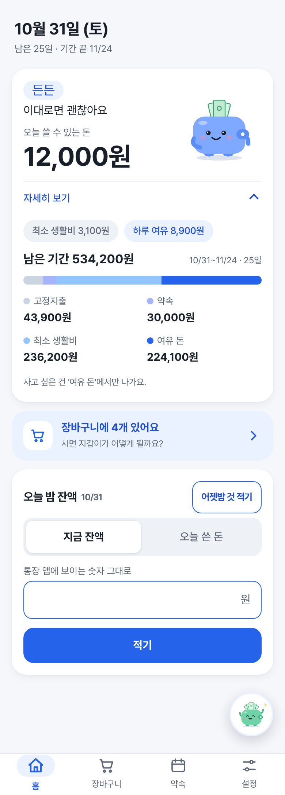 | 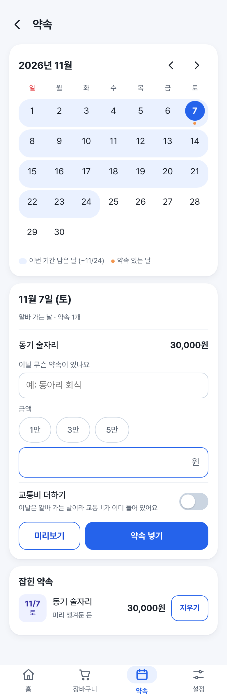 |

| 장바구니 미리보기 | 나눠 사기 | 산 뒤 다시 짜기 |
|---|---|---|
| 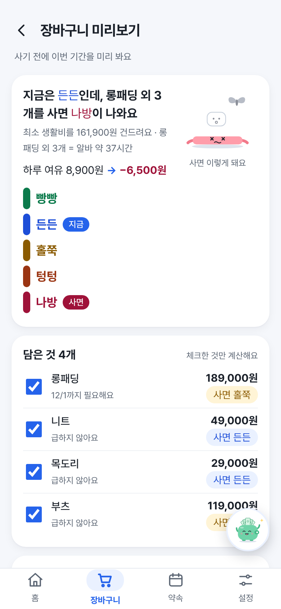 |  | 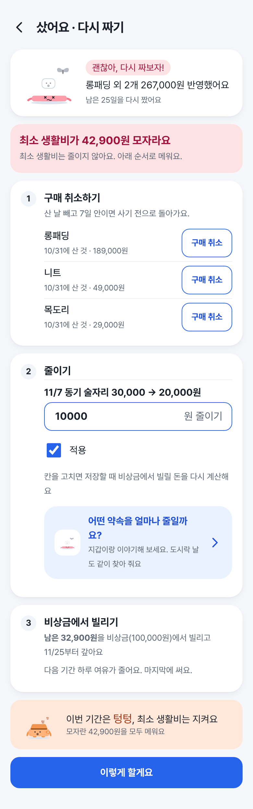 |

| 시작 | 첫 설정 5/5 | 기간 고르기 |
|---|---|---|
| 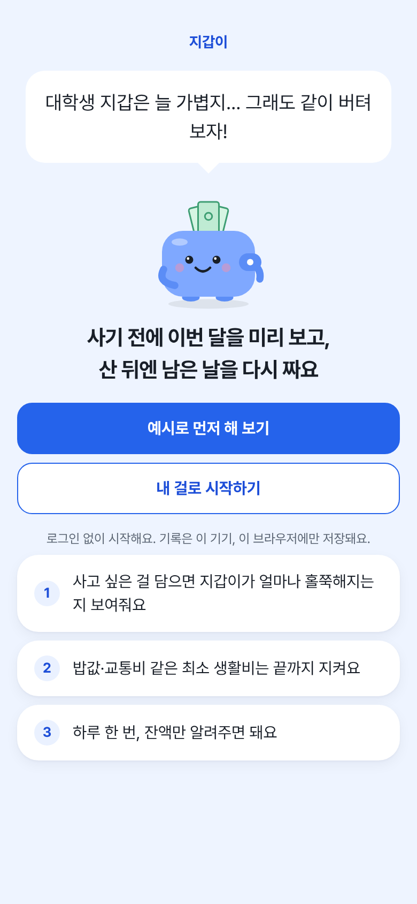 | 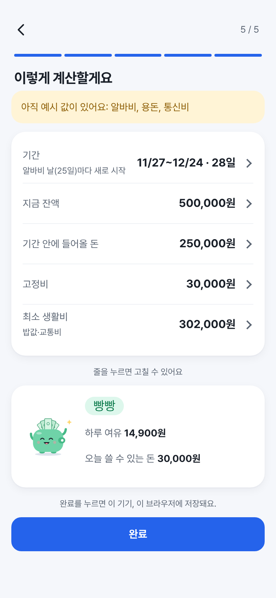 | 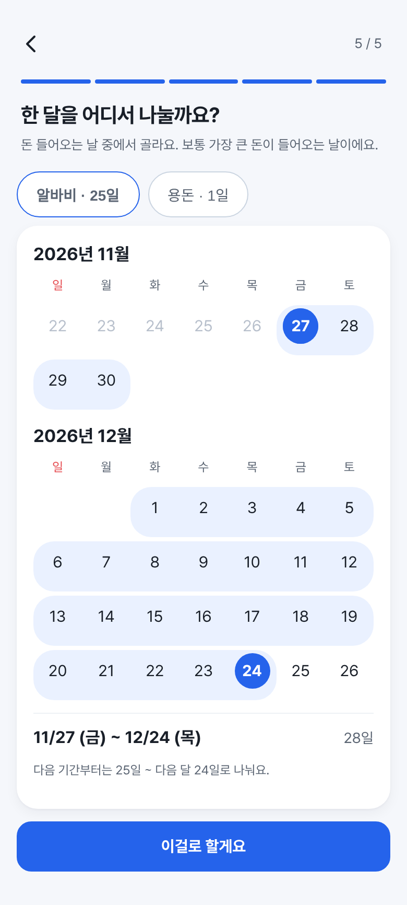 |

| 설정 | 지난 기간 돌아보기 | 산 뒤 장바구니 |
|---|---|---|
| 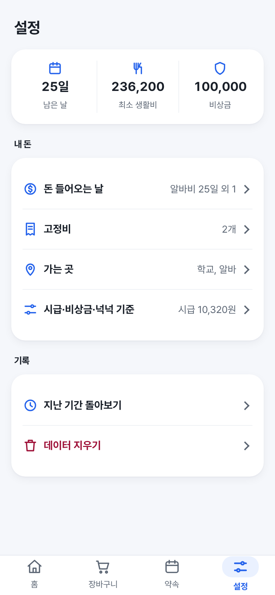 | 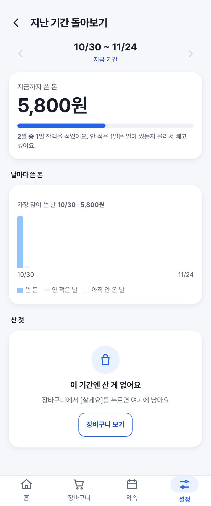 | 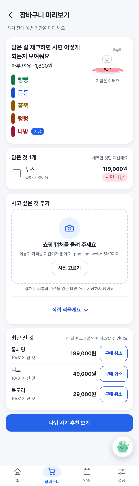 |

### 3.1 홈: 오늘 쓸 수 있는 돈과 지갑이 5단계 (R5~R8)

홈에는 숫자 하나만 크게 보여준다. **오늘 쓸 수 있는 돈 = 오늘의 최소 생활비 + 하루 여유 + 오늘 약속 금액.**

- **하루 여유** = 여유 돈 ÷ 남은 날 (100원 아래 버림)
- **여유 돈** = 쓸 수 있는 돈 − 고정지출 − 남은 약속 − 최소 생활비 − 이번 기간에 갚을 비상금
- [자세히 보기]를 누르면 남은 기간의 돈이 어디로 가는지 막대 하나로 보여준다 (R7-1)

하루 여유를 사용자가 정한 '넉넉 기준'(기본 10,000원)과 비교해서 지갑이 캐릭터가 다섯 단계로 바뀐다.

| 단계 | 조건 (넉넉 기준 10,000원일 때) | 뜻 |
|---|---|---|
| 빵빵 | 하루 여유 10,000원 이상 | 넉넉하다 |
| 든든 | 5,000원 이상 | 이대로면 괜찮다 |
| 홀쭉 | 1,000원 이상 | 빠듯하다 |
| 텅텅 | 0원 이상 | 남는 게 거의 없다 |
| 나방 | 0원 미만 | 최소 생활비를 건드린다 |

### 3.2 장바구니 미리보기 (R11)


- 사고 싶은 것을 담아 두고, **체크한 것만** 샀다고 치고 다시 계산한다
- 물건마다 '그것 하나만 사면 무슨 단계인지' 칩이 붙는다 (사면 홀쭉, 사면 든든 …)
- 최소 생활비를 건드리면 "최소 생활비를 161,900원 건드려요 · 알바 약 37시간"처럼 얼마나 모자란지와 **알바 몇 시간 어치인지**를 보여준다 (시급은 설정에서 바꾼다, 기본 10,320원)
- 필요한 날(예: 12/1까지)을 적어 두면 나눠 사기가 그 날짜를 지킨다
- 쇼핑 화면 캡처를 올리면 이름과 가격을 채워 준다 (AI, 선택)

<br clear="right">

### 3.3 나눠 사기 (R13)

한 번에 사면 나방이 될 때, 물건마다 **이번 기간 · 다음 기간 · 그다음 기간** 중 언제 살지 모든 경우를 따져서 고른다.

1. 나방이 나오지 않고, 필요한 날 전에 산다 (이 조건을 못 지키는 경우는 버린다)
2. 모든 기간이 홀쭉 이상
3. 더 일찍 사는 쪽 (물건마다 기다리는 기간 수의 합이 작은 쪽)
4. 가장 빠듯한 기간이 덜 빠듯한 쪽

체크한 물건은 8개까지 (3⁸ = 6,561가지). 다음 기간은 예상 수입으로 계산한다.
[이 계획으로 살게요]를 누르면 지금 살 것은 산 것으로, 나중에 살 것은 '계획'으로 저장되고, 계획한 물건값은 사거나 취소할 때까지 약속처럼 여유 돈에서 빠진다.

### 3.4 산 뒤 다시 짜기 (R14)

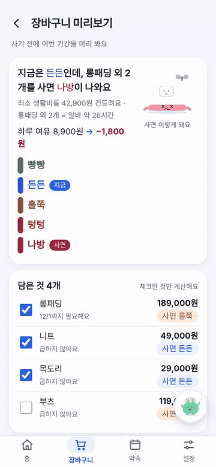

[그래도 지금 살게요]로 사서 여유 돈이 0 아래로 내려가면 다시 짜기 화면이 나온다. 모자란 돈을 이 순서로 메운다.

1. **구매 취소**: 산 날 빼고 7일 안이면 사기 전으로 돌린다
2. **줄이기**: 앞으로 있을 약속을 금액의 1/3(천 원 버림)씩 줄이자고 제안한다. 칸에서 고칠 수 있다
3. **비상금에서 빌리기**: 그래도 남으면 비상금에서 빌리고 다음 기간 첫날 갚는다. 다음 기간 하루 여유가 얼마나 줄어드는지도 보여준다

줄이기 칸 아래 **'지갑이랑 이야기해 보기'** 를 누르면, 어떤 약속을 줄여도 되는지 말로 알려 주고 지갑이가 도시락 날과 함께 메울 방법을 골라 준다 (R23, AI). 약속이 얼마나 중요한지는 사용자만 알기 때문에 AI가 알아서 고르지 않는다.

[이렇게 할게요]를 누르기 전까지는 아무것도 바뀌지 않는다. 산 것은 장바구니 '최근 산 것'에서, 계획은 홈 '자세히 보기'에서 되돌릴 수 있다 (R18).

<br clear="right">

### 3.5 약속 달력 (R9)

- 한 달 달력에서 날을 누르면 그날 아래에서 바로 약속을 넣는다
- 그날 학교·알바를 안 가는 날이면 교통비 체크가 켜진 채로 시작한다 (가는 날이면 이미 교통비가 최소 생활비에 들어 있으니 꺼진 채로)
- 넣기 전에 [미리보기]로 하루 여유가 얼마나 줄어드는지 먼저 본다 (예: 11/13 금 50,000원 + 교통비 3,100원 → 하루 여유 8,900 → 6,800원)

### 3.6 밤 잔액: 하루 한 번 통장 잔액만 (R10)

- 홈 맨 아래에 그날 밤 통장 잔액을 적는다. **쓴 돈은 앱이 거꾸로 계산한다**: 쓴 돈 = 지난 잔액 + 들어온 돈 − 빠져나간 고정지출 − 산 물건 − 지금 잔액
- 쓴 돈 중 그날 최소 생활비·약속을 넘은 만큼만 여유 돈에서 빠진다
- 잔액을 모르면 [오늘 쓴 돈] 칸에 쓴 돈을 적는다. 앱이 "그럼 지금 ○원이겠네요, 맞나요?"로 잔액을 계산해 확인받는다 (R10-1)
- 며칠 빼먹어도 된다. 안 적은 날은 최소 생활비와 약속만큼 썼다고 보고, 다음에 적을 때 한꺼번에 맞춘다
- 어젯밤 것을 깜빡했으면 [어젯밤 것 적기]

### 3.7 첫 설정 5단계 (R17)

1. 지금 통장 잔액
2. 돈 들어오는 날 (알바비 25일, 용돈 1일 …) — 아래에 "알바비 날(25일)마다 한 달을 나눠요 · 11/27 ~ 12/24"처럼 기간이 어떻게 나뉘는지 한 줄로 보여준다
3. 매달 나가는 고정비 (통신비, 구독 …)
4. 매주 가는 곳 (학교 월~금, 끼니 2끼 × 6,000원, 왕복 교통비 3,100원 …)
5. 확인: 첫날 홈과 똑같은 계산으로 여유 돈·하루 여유·지갑이 단계를 미리 보여준다

- 모든 칸이 예시 값으로 채워져 있고, 예시 값을 그대로 둔 줄은 5/5에서 알려 준다
- 한 달을 어디서 나눌지(기간 시작일)는 앱이 정한다: 금액이 가장 큰 수입의 날. 5/5의 기간 줄을 누르면 **달력에서 기간을 보면서** 다른 수입 날로 바꿀 수 있다

### 3.8 설정과 지난 기간 돌아보기 (R15)

- 돈 들어오는 날·고정비·가는 곳·시급·비상금·넉넉 기준을 고친다
- 가는 곳을 고치면 **오늘부터 새 줄**로 들어가고 예전 줄은 어제로 끝난다. 그래서 지난 날 계산은 바뀌지 않는다 (예: 11/16에 학교 끼니 2→1로 바꾸면 10/30~11/15 최소 생활비 139,400원은 그대로, 11/16~11/24만 96,800 → 60,800원)
- 지난 기간 돌아보기: 기간마다 쓴 돈, 잔액을 적은 날 수, 날마다 막대, 그 기간에 산 것
- 데이터 지우기: 내 기록을 전부 지우고 쿠키도 지운다

### 3.9 AI 기능 (선택, R20~R23)

`.env`에 OpenAI API 키를 넣으면 켜지고, 키가 없으면 이 기능만 숨겨진다.

**원칙: 숫자는 앱이 계산하고, AI는 앱이 준 선택지 안에서 고르거나 칸을 채우기만 한다. 저장은 사용자가 버튼을 눌러야 한다.**

<!-- 녹화 후 넣기: docs/screens/14_chat_plan.png, 15_chat_shop.png, 16_chat_cut.png (실제 키로 찍은 화면) -->

| 기능 | 어디서 | 하는 일 | 저장은 |
|---|---|---|---|
| 캡처로 담기 (R20) | 장바구니 '쇼핑 캡처를 올려 주세요' | 캡처에서 상품 이름과 지금 낼 가격(할인 뒤, 배송비 빼고)을 읽어 칸을 채운다. 캡처는 저장하지 않는다 | [추가] |
| 무신사에서 찾기 (R21) | 홈·장바구니 오른쪽 아래 지갑이 버튼 | "15만 원 아래 겨울 코트"처럼 말하면 musinsa.com만 웹 검색해서 4개까지 고른다. 예산은 앱이 계산해서 준다(든든을 지키는 금액). 상품마다 '사면 단계' 칩이 붙는다. 하루 20번까지 | [장바구니에 담기] |
| 계획 짜기 (R22) | 채팅 '계획 짜기' | 앱이 계산한 선택지(도시락 날, 모아 두기) 안에서 다음 돈 들어오는 날까지의 계획을 제안한다. 하루 여유가 어떻게 바뀌는지는 앱이 계산한다. 끼니를 거르라는 제안은 하지 않는다 | [이대로 적용] |
| 채팅으로 줄이기 (R23) | 다시 짜기 '지갑이랑 이야기해 보기' | 사용자가 말한 '줄여도 되는 약속'과 도시락 날 안에서만 고른다. 앱이 다시 확인해서 약속마다 1/3 넘게, 모자란 돈보다 많이 줄이지 않는다 | [이대로 적용] |

```
OPENAI_API_KEY=키
OPENAI_MODEL=gpt-6.1-terra
```

- 무신사 사이트는 직접 긁지 않는다. OpenAI 웹 검색에 도메인 필터(musinsa.com)를 걸어서, 검색에서 실제로 본 페이지만 카드로 보여준다. 가격은 무신사에서 다시 확인하라고 알린다
- 실제 키로 잰 응답 시간: 캡처 읽기 약 5초, 계획 짜기 4~7초, 무신사 찾기 20초 안팎

---

## 4. 계산은 이렇게 한다 (예시 사람으로 따라가기)

`db/seed.sql`의 김대학 씨로 화면의 숫자가 어디서 나오는지 따라가 본다. 모든 숫자는 [docs/rules.md](docs/rules.md) '확인용 예시'와 같고, 테스트가 지킨다.

**김대학 씨**
- 학교: 월~목, 학식 2끼 × 6,000원 + 왕복 3,100원 → 학교 가는 날 최소 생활비 15,100원
- 알바: 토·일, 끼니는 집에서, 왕복 3,100원 → 알바 가는 날 3,100원
- 용돈 매달 1일 250,000원, 알바비 매달 25일 420,000원 (알바비 날이 기간 시작)
- 고정지출 43,900원(통신비 5일, 음악 구독 12일), 11/7 동기 술자리 30,000원, 비상금 100,000원
- 10/30(금) 잔액 290,000원으로 시작, 그날 밤 5,800원 씀

**기간**: 10/30 ~ 11/24 (다음 알바비 날 전날까지). 10/31 아침 기준 남은 날 25일 (10/31~11/24)

| 항목 | 계산 | 값 |
|---|---|---|
| 쓸 수 있는 돈 | 시작 잔액 290,000 + 11/1 용돈 250,000 | 540,000 |
| 최소 생활비 (10/31~11/24) | 학교 14일 × 15,100 + 알바 8일 × 3,100 + 그 외 3일 × 0 | 236,200 |
| 여유 돈 (10/30) | 540,000 − 고정지출 43,900 − 약속 30,000 − 최소 생활비 236,200 | 229,900 |
| 여유 돈 (10/31) | 229,900 − (10/30 밤 쓴 돈 5,800 − 그날 최소 생활비 0) | 224,100 |
| 하루 여유 | 224,100 ÷ 25 = 8,964 → 100원 아래 버림 | 8,900 (든든) |
| 오늘(토) 쓸 수 있는 돈 | 알바 교통비 3,100 + 하루 여유 8,900 | 12,000 |
| 남은 기간 막대 | 43,900 + 30,000 + 236,200 + 224,100 | 534,200 |

**장바구니 미리보기** (롱패딩 189,000 · 니트 49,000 · 목도리 29,000 · 부츠 119,000)

| 체크한 것 | 계산 | 하루 여유 |
|---|---|---|
| 롱패딩 하나 | (224,100 − 189,000) ÷ 25 = 1,404 | 1,400 (홀쭉), 알바 18시간 |
| 4개 다 (386,000) | (224,100 − 386,000) ÷ 25 = −6,476 → 내림 | −6,500 (나방), 최소 생활비 161,900원 침범, 알바 37시간 |

**나눠 사기**: 지금 니트·목도리·부츠(197,000) → (224,100 − 197,000) ÷ 25 = 1,084 → **1,000 홀쭉** / 11/25 롱패딩 → 다음 기간 여유 돈 389,900 − 189,000 = 200,900, ÷ 30일 = **6,600 든든**

**다시 짜기** (롱패딩·니트·목도리 267,000을 한 번에 산 경우)

| 단계 | 계산 | 남은 모자란 돈 |
|---|---|---|
| 산 뒤 | 224,100 − 267,000 | −42,900 |
| 줄이기 | 11/7 술자리 30,000의 1/3 = 10,000 | −32,900 |
| 비상금 | 32,900 빌리고 11/25에 갚음 | 0 (텅텅) |
| 다음 기간 | (389,900 − 32,900) ÷ 30 | 하루 여유 11,900 |

채팅으로 줄이기(R23)에서 "술자리는 1차만 갈게"라고 하면: 술자리 10,000 + 도시락 11/2·11/3(6,000 × 2) = 22,000을 메우고, 남은 20,900만 비상금에서 빌린다.

---

## 5. 실행 방법

### 준비

- [Docker Desktop](https://www.docker.com/products/docker-desktop/) (Windows·Mac) 또는 Docker Engine + Compose (Linux)
- 8000번(웹)과 3317번(DB) 포트가 비어 있어야 한다

### 실행

```bash
git clone https://github.com/psj-png/jigabi-budget.git
cd jigabi-budget
cp .env.example .env          # Windows cmd: copy .env.example .env
docker compose up --build
```

- 처음 실행할 때는 MySQL이 `db/schema.sql`(테이블)과 `db/seed.sql`(예시 사람)을 넣느라 **1분쯤** 걸린다. web은 DB 준비가 끝난 뒤에 뜬다
- 브라우저에서 **http://localhost:8000** 을 연다
  - 처음 여는 브라우저면 시작 화면이 나온다: [예시로 먼저 해 보기] 또는 [내 걸로 시작하기]
  - **http://localhost:8000/demo** 는 시작 화면을 건너뛰고 바로 예시 사람 홈으로 간다
- 끌 때는 `Ctrl+C` 또는 `docker compose down`. 기록은 DB 볼륨에 남는다

### 기록은 어디에 남나 (시작 화면이 다시 안 나올 때)

로그인이 없다. 첫 설정을 마치면 이 브라우저에 익명 ID 쿠키(`jigabi_id`, 1년)가 생기고, 기록은 그 ID로 DB에 남는다 (R19).
그래서 **한 번 첫 설정을 한 브라우저는 http://localhost:8000 을 열면 바로 내 홈이 나온다.** 버그가 아니다.

| 하고 싶은 것 | 방법 |
|---|---|
| 시작 화면을 다시 보기 | http://localhost:8000/start |
| 처음 사용자처럼 처음부터 | 시크릿(사생활 보호) 창으로 열기 |
| 내 기록을 지우고 다시 시작 | 설정 → 데이터 지우기 |
| 둘러보기를 끝내고 내 홈으로 | 맨 위 띠의 [내 걸로 시작하기] (`/demo/exit`) |
| DB를 seed 상태로 되돌리기 | `docker compose down -v` 후 `docker compose up --build` (모든 기록이 지워진다) |

- 둘러보기는 따로 쿠키(`jigabi_demo`, 브라우저를 닫으면 사라짐)를 써서, 둘러봐도 내 기록은 그대로다
- 다른 기기·다른 브라우저에서는 기록을 이어 쓸 수 없다. **카카오톡 안에서 링크를 열면 카톡 브라우저라 기록이 따로 논다. 사파리·크롬으로 연다**

### 날짜 고정하기

모든 화면 주소에 `?today=YYYY-MM-DD`를 붙이면 그 날짜를 오늘로 보고 계산한다. 예시 사람은 늘 2026-10-31로 고정된다.

```
http://localhost:8000/?today=2026-11-07         # 약속 있는 날의 홈
http://localhost:8000/setup?today=2026-11-27    # 11/27에 첫 설정하는 사람
```

### 휴대폰에서 보기

PC와 휴대폰을 같은 와이파이에 두고 휴대폰에서 `http://<PC의 IP>:8000` 을 연다 (Windows는 `ipconfig`의 IPv4 주소).
안 열리면 Windows 네트워크 프로필을 '개인'으로 바꾸고 방화벽에서 Docker Desktop을 허용한다. 학교·카페 와이파이는 기기끼리 막는 경우가 있어서 휴대폰 핫스팟이 확실하다.

### 자주 막히는 곳

| 증상 | 원인과 해결 |
|---|---|
| `port is already allocated` | 8000이나 3317을 다른 프로그램이 쓰고 있다. 그 프로그램을 끄거나 `docker-compose.yml`의 왼쪽 포트 번호를 바꾼다 |
| 코드를 고쳤는데 화면이 그대로 | web 이미지에 코드가 들어 있다. `docker compose up -d --build web` |
| 테이블을 바꿨는데 반영이 안 된다 | schema는 DB 볼륨이 비어 있을 때만 들어간다. `docker compose down -v` 후 다시 실행 |
| 채팅 버튼·캡처 상자가 안 보인다 | `.env`에 `OPENAI_API_KEY`가 비어 있다. 정상이다 (AI만 꺼짐) |

---

## 6. 테스트

DB 테스트는 개발 DB(`jigabi`)가 아니라 `jigabi_test`를 쓴다. 테스트를 시작할 때마다 `jigabi_test`를 지우고 `schema.sql` + `seed.sql`로 새로 만든다.

```bash
docker compose up -d db                       # DB만 띄워도 된다
pip install -r requirements.txt pytest httpx
DB_HOST=127.0.0.1 DB_PORT=3317 DB_PASSWORD=<.env의 MYSQL_ROOT_PASSWORD> python -m pytest -q
```

Windows cmd:

```bat
set DB_HOST=127.0.0.1& set DB_PORT=3317& set DB_PASSWORD=change-me& python -m pytest -q
```

- 결과에 **skipped가 0**인지 본다. DB에 못 붙으면 DB 테스트가 실패하지 않고 skipped로 넘어가기 때문이다
- GitHub Actions(`.github/workflows/test.yml`)가 push마다 MySQL 8.4를 띄워 같은 테스트를 돌리고, **skipped가 하나라도 있으면 실패**로 본다
- AI 테스트는 OpenAI를 부르지 않고 가짜 응답으로 돈다. 키가 없어도 된다

| 파일 | 개수 | 확인하는 것 |
|---|---|---|
| `test_calc.py` | 41 | 계산 함수(R1~R13): 기간, 최소 생활비, 하루 여유 버림, 단계, 나눠 사기 순서 |
| `test_queries.py` | 45 | seed DB로 화면 숫자(rules.md 확인용 예시), 밤 잔액, 산 것·구매 취소, 다시 짜기, 설정 바꾸기, 무결성 제약 |
| `test_setup.py` | 16 | 첫 설정 폼 검사와 5/5 미리보기 숫자 |
| `test_setup_flow.py` | 5 | 첫 설정을 브라우저처럼 눌러 보기 (장소 지우기 확인, 뒤로 가기, 기간 고르기) |
| `test_ai.py` · `test_shop.py` · `test_plan.py` | 15 | AI가 준 답을 앱이 다시 확인하는지 (목록 밖 상품·선택지 버리기, 한도 자르기) |

---

## 7. 구조

### 기술 스택

| 부분 | 쓴 것 | 이유 |
|---|---|---|
| 서버 | Python 3.13, FastAPI | 폼 처리와 화면 렌더링이 간단하다 |
| 화면 | Jinja2 서버 렌더링, CSS | 자바스크립트 파일 없이 form과 링크로만 움직인다 (체크하면 바로 다시 계산하는 `onchange` 한 줄 정도만 쓴다). 휴대폰에서 가볍다 |
| DB | MySQL 8.4, PyMySQL | ORM 없이 SQL을 직접 쓴다 (어떤 쿼리가 나가는지 코드에서 바로 보이게) |
| 실행 | Docker Compose | `docker compose up` 한 줄로 DB와 웹이 같이 뜬다 |
| AI (선택) | OpenAI API | 캡처 읽기(structured outputs), 무신사 검색(Responses API + web search) |

### 폴더

```
app/
  main.py        주소(라우트)마다 화면을 고르고 폼을 받는다
  calc.py        계산만 한다. DB를 모르고 값만 받아서 계산 (R1~R13)
  queries.py     SQL을 모아 둔 곳. 읽어서 calc가 받는 모양으로 돌려준다 (commit은 부르는 쪽이 한다)
  home.py        홈 화면 값 (queries로 읽고 calc로 계산)
  balance.py     밤 잔액 적기와 쓴 돈 계산 (R10)
  cart.py        장바구니 미리보기 (R11)
  split.py       나눠 사기 (R13)
  purchase.py    산 것·구매 취소·나눠 사기 저장을 한 트랜잭션으로 (R14-0)
  replan.py      다시 짜기 (R14)
  setup.py       첫 설정 폼 검사, 미리보기, 저장 (R17)
  settings.py    설정 바꾸기, 지난 기간 돌아보기 (R15)
  ai.py          OpenAI 호출 (R20~R23)
  shop.py        무신사 찾기 채팅 (R21)
  plan.py        계획 짜기·채팅으로 줄이기 (R22·R23)
  templates/     화면 (Jinja2)
  static/        CSS, 글꼴
db/
  schema.sql     테이블 12개
  seed.sql       예시 사람 김대학 씨
  make_synth.py  인덱스 실험용 합성 데이터 (100명, 학기·4년)
  bench_index.py 인덱스 전후 비교 스크립트
docs/
  rules.md       계산 규칙 R1~R23과 확인용 숫자
  bench.md       인덱스 실험 결과
  screens/       README 화면
tests/           pytest
```

### 요청 하나가 지나가는 길

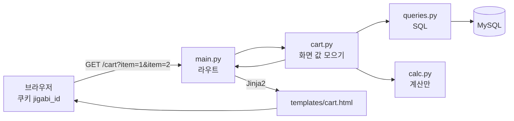

계산(`calc.py`)과 SQL(`queries.py`)을 나눠서, 계산 함수는 DB 없이 테스트하고 화면 숫자는 seed DB로 따로 테스트한다. 저장할 때는 화면 모듈이 여러 쿼리를 **한 트랜잭션**으로 묶는다 (예: 나눠 사기 저장 = 산 것 3개 + 계획 1개를 한 번에 commit, 중간에 실패하면 전부 rollback).

---

## 8. DB 설계

### ERD

```mermaid
erDiagram
    users ||--o{ routines : "가는 곳"
    routines ||--|{ routine_days : "요일"
    users ||--o{ incomes : "들어오는 돈"
    users ||--o{ fixed_costs : "고정비"
    users ||--o{ appointments : "약속"
    users ||--o{ wish_items : "장바구니"
    users ||--o{ balance_logs : "밤 잔액"
    users ||--o{ periods : "기간"
    users ||--o{ loans : "비상금 빌림"
    users ||--o{ chat_messages : "지갑이 채팅"
    users ||--o{ plan_changes : "바꾼 계획"

    users {
        INT user_id PK
        CHAR public_id UK "쿠키 익명 ID"
        INT comfort_daily "넉넉 기준"
        INT hourly_wage
        INT emergency_fund "비상금"
        INT grocery_weekly
        DATETIME created_at
    }
    routines {
        INT routine_id PK
        INT user_id FK
        VARCHAR name
        INT round_trip_fare
        TINYINT meals_out
        INT meal_price
        DATE start_date "고치면 새 줄"
        DATE end_date "예전 줄은 어제로"
    }
    routine_days {
        INT routine_id PK, FK
        TINYINT weekday PK "0=월"
    }
    incomes {
        INT income_id PK
        INT user_id FK
        VARCHAR name
        TINYINT day_of_month
        INT amount
        BOOLEAN is_main "기간 기준"
        INT main_user UK "VIRTUAL, 주 수입 하나만"
    }
    fixed_costs {
        INT fixed_id PK
        INT user_id FK
        VARCHAR name
        TINYINT day_of_month
        INT amount
    }
    appointments {
        INT appt_id PK
        INT user_id FK
        DATE appt_date
        VARCHAR title
        INT amount
        INT transport_fare
    }
    wish_items {
        INT item_id PK
        INT user_id FK
        VARCHAR name
        INT price
        DATE need_by
        VARCHAR url "무신사 링크"
        ENUM status "wish planned bought returned"
        DATE planned_date
        DATE bought_date
        DATE received_date
        DATE returned_date
    }
    balance_logs {
        INT log_id PK
        INT user_id FK "UK(user_id, log_date)"
        DATE log_date
        INT balance
        INT income_in
        INT spent "계산해 저장"
    }
    periods {
        INT period_id PK
        INT user_id FK "UK(user_id, start_date)"
        DATE start_date
        DATE end_date
        INT opening_balance
        INT repay_amount
    }
    loans {
        INT loan_id PK
        INT user_id FK
        DATE borrowed_on
        INT amount
    }
    chat_messages {
        INT message_id PK
        INT user_id FK "IDX(user_id, chat_day)"
        DATE chat_day
        ENUM role
        ENUM mode "shop plan"
        VARCHAR content
        JSON items_json
        JSON plan_json
        TINYINT applied
        DATETIME created_at
    }
    plan_changes {
        INT change_id PK
        INT user_id FK "UK(user_id, day, kind)"
        DATE day
        ENUM kind "meal save"
        INT amount
        VARCHAR note
        DATETIME created_at
    }
```

### 테이블 12개

| 테이블 | 한 줄 | 쌓이는 정도 |
|---|---|---|
| `users` | 사람 하나. 쿠키 익명 ID(`public_id`), 넉넉 기준, 시급, 비상금 | 사람당 1 |
| `routines` · `routine_days` | 매주 가는 곳과 요일. 고치면 새 줄을 넣고 예전 줄은 `end_date`로 끝낸다 | 사람당 몇 줄 |
| `incomes` | 돈 들어오는 날. `is_main`이 기간 시작 | 사람당 몇 줄 |
| `fixed_costs` | 매달 나가는 돈 | 사람당 몇 줄 |
| `appointments` | 약속 (금액 + 교통비) | 한 달 몇 줄 |
| `wish_items` | 장바구니. `status`가 담음 → 계획 → 산 것 → 구매 취소로 바뀐다 | 한 달 몇 줄 |
| `balance_logs` | 밤 잔액. 하루 한 줄 | **가장 많이 쌓인다** (사람당 1년 365줄) |
| `periods` | 기간(알바비 날 ~ 다음 알바비 날 전날)과 시작 잔액, 갚을 비상금 | 한 달 1줄 |
| `loans` | 비상금에서 빌린 돈 | 가끔 |
| `chat_messages` | 지갑이 채팅. 하루 20번 제한을 여기서 센다 | AI를 쓰면 많이 |
| `plan_changes` | 계획 도우미로 바꾼 것 (도시락 날, 모아 두기) | 가끔 |

### 제약과 설계 결정

| 무엇 | 어떻게 | 왜 |
|---|---|---|
| 주 수입은 한 사람에 하나 | 생성 칼럼 `main_user INT AS (IF(is_main, user_id, NULL)) VIRTUAL` + `UNIQUE` | 주 수입 줄만 `user_id`를 갖고 나머지는 NULL. UNIQUE는 NULL을 여러 개 허용하므로 '사람마다 is_main=TRUE는 한 줄'이 된다. STORED 생성 칼럼은 `ON DELETE CASCADE` 외래키가 걸린 칼럼(`user_id`)을 쓸 수 없어서 VIRTUAL로 했다 |
| 같은 기간이 두 번 생기지 않게 | `periods UNIQUE(user_id, start_date)` + `INSERT IGNORE` | 기간 행은 홈을 열 때 없으면 만든다(R1-2). 두 요청이 겹쳐도 한 줄만 남는다. 무시됐을 때 비상금 갚기가 두 번 잡히지 않도록 `rowcount`를 보고 뒷일을 한다 |
| 밤 잔액은 하루 한 줄 | `balance_logs UNIQUE(user_id, log_date)` + `INSERT … ON DUPLICATE KEY UPDATE` | 같은 날 다시 적으면 덮어쓴다 |
| 계획은 하루·종류마다 한 줄 | `plan_changes UNIQUE(user_id, day, kind)` | 같은 날 도시락을 두 번 넣지 않게 |
| 쓴 돈을 저장 | `balance_logs.spent` (반정규화) | 다른 칼럼으로 계산할 수 있지만, 지난 기간 돌아보기에서 날마다 다시 계산하지 않으려고 저장할 때 앱이 계산해 넣는다 |
| 가는 곳 이력 | `routines.start_date` / `end_date` | 설정을 바꿔도 지난 날 최소 생활비가 바뀌지 않게 (R15) |
| 사람을 지우면 전부 | 모든 외래키 `ON DELETE CASCADE` | 설정 → 데이터 지우기가 `DELETE FROM users` 한 줄로 끝난다 |
| 실제 카드·계좌 정보는 없음 | 잔액 숫자만 사람이 적는다 | 저장소와 DB에는 예시·합성 데이터만 있다 |

### 인덱스 실험

합성 데이터(`db/make_synth.py`, 100명, `random.seed(42)`)를 한 학기(109일)와 4년(1,461일) 두 크기로 만들고 인덱스 전후를 비교했다. 전체 표는 [docs/bench.md](docs/bench.md).

| 쿼리 | 인덱스 | 4년, 가장 많이 쓴 사람 | 결정 |
|---|---|---|---|
| 채팅 하루 횟수 `count_chat_today` | `(user_id, chat_day)` | 읽은 행 29,186 → **8**, 39.63ms → **1.53ms** (약 26배) | 넣음 |
| 약속 목록 `get_appointments` | `(user_id, appt_date)` | 읽은 행 458 → 458, 정렬(filesort)은 사라지지만 19.14ms → 20.37ms로 그대로 | 안 넣음 (날짜 조건을 같이 붙일 때만 458 → 9행) |

인덱스는 '어떤 조건으로 줄이느냐'가 맞아야 효과가 있다는 걸 확인했다. 약속 목록은 지금 쿼리가 사람의 약속을 전부 읽기 때문에 인덱스로 줄일 행이 없다.

---

## 9. 만들면서 정한 것과 어려웠던 점

**'기간'을 사용자에게 묻지 않기로 했다.** 처음에는 첫 설정에서 "기간 기준 수입을 고르세요"라고 물었는데, 만든 나도 헷갈렸다. 지금은 금액이 가장 큰 수입의 날로 앱이 정하고, 5/5 확인에서 달력으로 보여준 뒤 바꾸고 싶으면 바꾸게 했다.

**둘러보기가 내 기록을 지워 버리는 버그.** 처음에는 `/demo`가 쿠키를 예시 사람 ID로 덮어써서, 내 기록이 있던 사람이 둘러보기를 누르면 내 ID를 영영 잃었다(로그인이 없으니 되찾을 방법도 없다). 둘러보기용 쿠키를 따로 두고 내 쿠키는 건드리지 않게 고쳤다.

**휴대폰에서 잘못 눌러 최소 생활비가 0원이 된 일.** 첫 설정 4/5에 '가는 곳이 없어요' 버튼이 있었는데, 휴대폰에서 스크롤하다 눌러서 학교가 통째로 지워졌다. 장소마다 [−]를 두고 "학교 지울까요? 밥값·교통비가 0원이 돼요"를 한 번 묻게 바꿨고, 이 흐름은 `test_setup_flow.py`로 다시 생기지 않게 막았다.

**제약을 넣으면 부수 효과도 봐야 한다.** 같은 기간이 두 번 생기지 않게 `INSERT IGNORE`를 넣었더니, 무시된 경우에도 뒤따르는 '비상금 갚기' 코드가 돌아서 갚을 돈이 두 번 잡혔다. 실제로 행이 들어갔는지(`rowcount`)를 보고 뒷일을 하게 고쳤다.

**AI는 약속이 얼마나 중요한지 모른다.** 산 뒤 모자랄 때 처음에는 버튼 하나로 AI가 줄일 약속을 고르게 했다. 그런데 친구 생일과 그냥 술자리 중 뭘 줄일지는 사용자만 안다. 그래서 사용자가 "술자리는 1차만"처럼 말하고, AI는 그 안에서만 고르고, 앱이 한도(약속마다 1/3, 모자란 돈까지)를 다시 확인하게 했다.

**숫자는 앱이 계산한다.** AI가 "하루 여유가 9,400원이 돼요"라고 말하게 두면 틀릴 수 있다. AI에게는 앱이 계산한 선택지만 주고, 화면의 숫자는 모두 `calc.py`가 낸다. AI가 목록에 없는 상품이나 선택지를 내면 앱이 버린다.

**규칙을 먼저 쓰고, 확인용 숫자로 지켰다.** 계산 규칙을 [docs/rules.md](docs/rules.md)에 먼저 적고, 예시 사람으로 손으로 계산한 숫자(예: 하루 여유 8,900원)를 테스트에 넣었다. 화면이나 코드를 크게 바꿀 때마다 이 숫자가 그대로인지로 회귀를 잡았다.

---

## 10. 아직 안 한 것과 한계

- **로그인이 없다.** 기록은 브라우저 쿠키 하나에 묶여서, 쿠키를 지우거나 기기를 바꾸면 이어 쓸 수 없다 (일부러 이렇게 했다: 가입 없이 바로 써 보게)
- **잔액 확인(R12)은 아직 안 만들었다.** 하루 여유는 괜찮아도 수입 전날 잔액이 0 아래로 가는 경우(돈이 들어오는 날보다 먼저 사는 경우)를 날짜순으로 따져 "용돈 들어온 뒤에 사기"를 권하는 기능. 규칙과 확인용 숫자만 있다
- 체크카드·계좌이체만 다룬다. 신용카드 할부, 배송 기간(받은 날 ≠ 산 날)은 따지지 않는다
- 장보기(`users.grocery_weekly`) 칼럼은 만들어 두고 아직 화면에서 쓰지 않는다
- 무신사 찾기는 응답이 20초 안팎으로 느리다
- 산 뒤에도 모자라면 '최소 생활비를 줄일지, 알바를 더 할지' 고르는 화면은 없다. 남는 금액과 알바 시간만 보여준다

---

## 11. 참고한 코드·자료

- 글꼴 [Pretendard](https://github.com/orioncactus/pretendard) (SIL Open Font License 1.1). 파일과 라이선스는 `app/static/fonts/`에 그대로 넣었다
- 글꼴 [Jua](https://fonts.google.com/specimen/Jua) (Google Fonts, SIL Open Font License 1.1)
- [FastAPI](https://fastapi.tiangolo.com/), [Jinja2](https://jinja.palletsprojects.com/), [PyMySQL](https://github.com/PyMySQL/PyMySQL) 공식 문서
- [MySQL 8.4 Reference Manual](https://dev.mysql.com/doc/refman/8.4/en/) — 생성 칼럼, `INSERT IGNORE`, `EXPLAIN ANALYZE`
- [OpenAI API 문서](https://platform.openai.com/docs) — structured outputs, Responses API 웹 검색
- 최저시급 10,320원(2026년)을 시급 기본값으로 썼다

---

## 12. 라이선스

[MIT](LICENSE)
